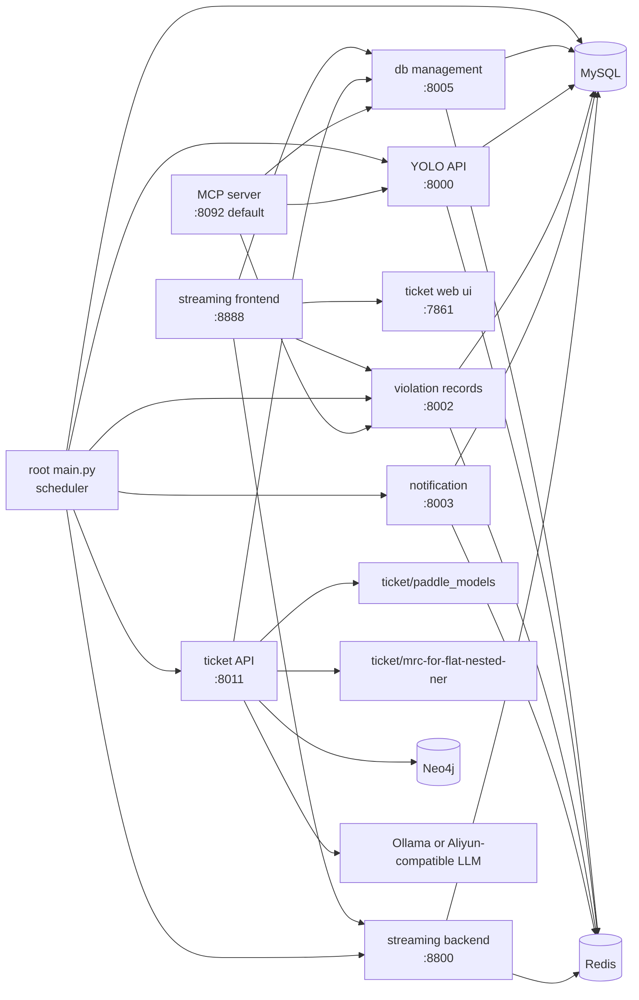

# 运行拓扑基线（Phase 0）

## 1. 拓扑图（当前真实链路）

## 2. 运行节点与角色

- 调度主控：根 `main.py`
- 管理配置：`examples/db_management`
- 视觉检测：`examples/YOLO_server_api/backend`
- 违章归档查询：`examples/violation_records`
- 通知发送：`examples/local_notification_server`
- 实时可视化：`examples/streaming_web/backend` + `examples/streaming_web/frontend`
- 工单联动：`ticket/service`（API + UI + pipeline）
- Agent 工具接入：`examples/mcp_server`

## 3. 主链路与非主链路

### 3.1 主链路（demo 主流程）

1. 配置站点/流（DB Management）
2. 根 `main.py` 读取 `stream_configs` 并启动流进程
3. 流进程调用 YOLO 检测
4. 有告警时写入 Violation Records，并发送 Notification
5. 帧与告警推送到 Streaming Backend，前端展示
6. 若启用 ticket 联动，生成 agent report 并可回写流配置

### 3.2 非默认主链路（但可联动）

- MCP server：提供工具化调用入口，不在 `start_services.bat` 默认启动序列内

## 4. 关键耦合点

- 五个 FastAPI 服务共享 `examples.auth.lifespan`，启动时统一初始化 Redis、建表、执行若干 `ALTER TABLE`
- 前端存在混合调用：
  - 一部分走 `vite /api -> :8800` 代理
  - 一部分直接写死 `http://127.0.0.1:8005`、`http://127.0.0.1:8002`、`http://127.0.0.1:7861`
- `ticket` 与监控侧通过 `POST /apply_ticket_to_site` + `X-Integration-Token` 形成强契约

