# 1000kV特高压淮南站工作票与视频台账联动专项方案

> 基于现有设备台账与摄像头清单设计，重点覆盖“工作票字段提取—标准设备匹配—摄像头/NVR通道定位—历史录像分析—任务合规判断”的完整链路。

## 1. 方案目的

本方案基于现有两类台账设计：

1. **摄像头清单**：包含站点所属名称、摄像头编号、通道编号、安装位置、监控区域、运行状态、视频留存周期等字段。
2. **设备台账**：包含站点、设备名称、电压等级、设备类型、所属间隔或单元、运行状态等信息。

目标是将工作票解析结果与设备台账、摄像头台账进行确定性关联，实现以下闭环：

```text
工作票识别
→ 识别站点、时间、地点、设备双重名称、任务和人员
→ 对应标准设备台账
→ 对应设备关联的摄像头及NVR通道
→ 调取工作票时间段录像
→ 提取人员实际作业片段
→ 判断时间、地点、设备、任务和安全措施是否一致
→ 输出正常、违规或待人工复核结果
```

本方案重点解决三个实际问题：

- 工作票里的自然语言怎样对应设备台账；
- 设备台账怎样进一步对应摄像头编号和NVR通道；
- 调出录像以后，怎样判断人员是否在正确设备上执行正确任务。

> 说明：当前依据为台账截图，设备台账表头和部分字段无法从截图中完整确认。正式建设时应使用原始Excel或数据库导入，截图中可确认的设备名称和摄像头编号仅用于说明映射方法，不作为最终生产台账。

## 2. 对现有台账的分析

### 2.1 摄像头台账已有字段

当前摄像头清单已具备：

| 现有字段 | 示例 | 联动用途 |
|---|---|---|
| 站点所属名称 | 1000kV特高压淮南站 | 限定查询站点 |
| 摄像头编号 | JK20 | 摄像头业务唯一标识 |
| 通道编号 | D11(NVR1) | 调用录像平台历史回放 |
| 安装位置 | 1号主变A相 | 初步关联区域或设备 |
| 监控区域 | 1号主变A相-西侧 | 表达具体视角和覆盖方向 |
| 运行状态 | 正常 | 判断是否具备取流条件 |
| 视频留存周期 | 2个月 | 判断历史录像是否仍可获取 |

这份台账已经可以支持“按摄像头编号和NVR通道调录像”，但还不能完全支持“按设备精确找摄像头”，原因是：

- 安装位置不一定等于被监控设备；
- 一个摄像头可能同时看到多台设备；
- 一台设备可能同时被两台或多台摄像头覆盖；
- 台账没有保存设备在画面中的ROI坐标；
- 台账没有主视角、辅助视角、可见度和遮挡程度；
- 保护小室等室内摄像头只写了南侧、中侧、北侧，没有细化到屏柜或保护装置。

### 2.2 设备台账可确认内容

从截图中可以确认部分标准设备或设备单元，例如：

- 1000kV淮Ⅰ线、1000kV淮Ⅱ线；
- 1000kV淮Ⅰ线主变T012；
- 1000kV淮Ⅱ线主变T022；
- 1000kV淮Ⅰ线主变T052、T062；
- 1号主变、2号主变；
- 1号主变5013开关；
- 2号主变5031开关、5032相关间隔；
- 500kV淮南5345线、5346线、5329线、5330线；
- 500kV相关线路开关5012、5022等；
- 110kV线路、111B站用变、112B站用变；
- 1号主变1112电抗器、2号主变1132电抗器；
- 0号、1号、2号站用变；
- 35kV相关站用变高压电缆。

设备表能够回答“工作票中的对象是哪台标准设备”，但不能直接回答“哪个摄像头能清晰看到它”。因此必须增加设备与摄像头之间的中间关系表。

### 2.3 当前最关键的数据缺口

现有台账之间主要依靠文本名称间接关联，生产系统需要新增：

> **设备—摄像头覆盖关系表（device_camera_coverage）**

这张表不是简单的名称匹配结果，而是现场人员查看每台摄像头实时画面后进行一次性确认和标定的正式台账。

## 3. 总体联动架构

```mermaid
flowchart LR
    A[工作票图片或PDF] --> B[OCR、版面识别和实体抽取]
    B --> C[工作票结构化草稿]
    C --> D[设备台账实体匹配]
    D --> E[人工确认和工作许可]
    E --> F[生效的期望作业模型]

    F --> G[查询设备—摄像头覆盖关系]
    G --> H[摄像头编号与NVR通道]
    H --> I[调用VMS或NVR历史回放]
    I --> J[工作时段长录像]
    J --> K[人员进入和运动粗筛]
    K --> L[有效作业短视频]
    L --> M[人员、设备、工具、PPE和动作识别]

    F --> N[标准任务模板和安全规则]
    M --> O[实际作业事实]
    N --> P[任务一致性判断]
    O --> P
    P --> Q[正常、违规或人工复核]
    Q --> R[截图、短视频、规则和处置记录]
```



## 4. 四张核心基础表

## 4.1 标准设备表 `asset_device`

由现有设备台账清洗导入，为每个设备分配永久唯一ID。

| 字段 | 类型 | 说明 |
|---|---|---|
| device_id | 字符串 | 系统内部唯一ID |
| station_id | 字符串 | 站点ID |
| station_name | 字符串 | 1000kV特高压淮南站 |
| device_name | 字符串 | 标准设备名称或双重名称 |
| device_code | 字符串 | 原设备编码，若现有台账具备则直接沿用 |
| voltage_level | 字符串 | 1000kV、500kV、110kV、35kV等 |
| device_type | 字符串 | 主变、开关、线路、间隔、电抗器、站用变、电缆、绝缘子等 |
| bay_name | 字符串 | 所属间隔或单元 |
| parent_device_id | 字符串 | 上级设备ID |
| phase | 字符串 | A、B、C或空 |
| location_code | 字符串 | 物理位置编码 |
| aliases | JSON数组 | OCR可能出现的别名 |
| running_status | 字符串 | 在运、停运、检修等 |
| source_row_id | 字符串 | 原始台账行标识 |
| verified | 布尔 | 是否人工核验 |

示例：

```json
{
  "device_id": "DEV-HN-TR01-A",
  "station_id": "ST-HN-1000KV",
  "station_name": "1000kV特高压淮南站",
  "device_name": "1号主变A相",
  "voltage_level": "1000kV",
  "device_type": "主变相单元",
  "bay_name": "1号主变间隔",
  "parent_device_id": "DEV-HN-TR01",
  "phase": "A",
  "aliases": ["1号主变A相", "1#主变A相", "一号主变A相"],
  "running_status": "在运",
  "verified": true
}
```

### 4.1.1 设备层级

建议建立以下层级：

```text
站点
└── 电压等级区域
    └── 间隔或主设备
        └── 相别或组成单元
            └── 具体部件
```

例如：

```text
1000kV特高压淮南站
└── 1000kV设备区
    └── 1号主变
        ├── 1号主变A相
        ├── 1号主变B相
        └── 1号主变C相
```

工作票若只写“1号主变检修”，系统应查找覆盖整个1号主变的摄像头；若写“1号主变A相套管检查”，则必须进一步精确到A相和具体部件。

## 4.2 摄像头通道表 `camera_channel`

由现有摄像头清单导入。

| 字段 | 示例 | 说明 |
|---|---|---|
| camera_id | JK20 | 摄像头编号 |
| station_id | ST-HN-1000KV | 标准站点ID |
| nvr_id | NVR1 | 从`D11(NVR1)`拆分 |
| channel_no | D11 | 从`D11(NVR1)`拆分 |
| installation_location | 1号主变A相 | 台账安装位置原文 |
| monitor_area | 1号主变A相-西侧 | 台账监控区域原文 |
| camera_type | FIXED/PTZ | 需补录 |
| playback_protocol | VMS/GB28181/SDK | 需补录 |
| vms_device_id | 平台通道ID | 需从视频平台获取 |
| stream_url | 实时取流地址 | 受权限保护 |
| online_status | 正常 | 摄像头状态 |
| retention_days | 60 | 由“2个月”转换 |
| time_offset_ms | 0 | 相对标准时间偏差 |
| enabled | true | 是否允许联动 |

原字段`D11(NVR1)`必须拆成`nvr_id=NVR1`和`channel_no=D11`，否则调用录像平台时不便检索。

## 4.3 设备—摄像头覆盖关系表 `device_camera_coverage`

这是工作票与视频联动的核心桥梁。

| 字段 | 说明 |
|---|---|
| coverage_id | 关系唯一ID |
| device_id | 标准设备ID |
| camera_id | 摄像头编号 |
| view_role | PRIMARY、SECONDARY、OVERVIEW |
| visible_part | 整体、套管、开关本体、操作机构、屏柜正面等 |
| roi_id | 设备在画面中的ROI编号 |
| roi_polygon | 多边形坐标 |
| work_zone_polygon | 人员作业区域ROI |
| forbidden_zone_polygon | 禁入区域ROI |
| view_direction | 西侧、东仰角侧、南侧等 |
| visibility_score | 0至1，可见度评分 |
| min_person_height_px | 适合人员/PPE识别的最小像素高度 |
| supports_device_check | 是否可以判断设备是否正确 |
| supports_action_check | 是否可以判断具体动作 |
| supports_ppe_check | 是否可以判断PPE |
| ptz_preset | 球机预置位，没有则为空 |
| valid_from、valid_to | 关系有效期 |
| verified_by、verified_at | 现场确认人和时间 |

示例：

```json
{
  "coverage_id": "COV-TR01A-JK20",
  "device_id": "DEV-HN-TR01-A",
  "camera_id": "JK20",
  "view_role": "PRIMARY",
  "visible_part": "1号主变A相西侧整体",
  "roi_id": "ROI-JK20-TR01A",
  "roi_polygon": [[420, 110], [1050, 100], [1110, 700], [360, 700]],
  "work_zone_polygon": [[250, 360], [1180, 350], [1240, 960], [180, 960]],
  "view_direction": "西侧",
  "visibility_score": 0.92,
  "supports_device_check": true,
  "supports_action_check": true,
  "supports_ppe_check": true,
  "verified_by": "现场运维人员"
}
```

> ROI坐标不能从摄像头清单或设备台账自动得到，必须在摄像头实际画面上标注。

## 4.4 标准作业任务模板表 `work_task_template`

工作票中的“检查、检修、试验、更换、清扫”等自然语言需要对应标准任务模板。

| 字段 | 说明 |
|---|---|
| task_code | 任务编码 |
| task_name | 标准任务名称 |
| applicable_device_types | 适用设备类型 |
| required_roles | 负责人、监护人、作业人员等 |
| allowed_tools | 允许出现的工具 |
| required_ppe | 必须佩戴的PPE |
| allowed_actions | 票内允许动作 |
| forbidden_actions | 明确禁止动作 |
| required_steps | 应完成的主要步骤 |
| video_observable_items | 视频能够判断的项目 |
| non_video_items | 必须通过人工或设备数据判断的项目 |
| thresholds | 持续时间和置信度阈值 |

示例：

```json
{
  "task_code": "TRANSFORMER_VISUAL_INSPECTION",
  "task_name": "主变外观检查",
  "applicable_device_types": ["主变", "主变相单元"],
  "required_roles": ["WORK_LEADER", "WORKER"],
  "required_ppe": ["HELMET", "WORK_CLOTHES"],
  "allowed_tools": ["CAMERA", "FLASHLIGHT", "RECORD_TERMINAL"],
  "allowed_actions": ["APPROACH", "OBSERVE", "TAKE_PHOTO", "RECORD"],
  "forbidden_actions": ["DISASSEMBLE", "WELD", "GRIND", "CLIMB_WITHOUT_PROTECTION"],
  "video_observable_items": ["设备区域", "人员数量", "PPE", "明显工具", "明显动作"],
  "non_video_items": ["内部电气状态", "测量值是否合格"],
  "thresholds": {
    "device_interaction_seconds": 10,
    "action_confidence": 0.85
  }
}
```

## 5. 面向联动的工作票设计

现有法定工作票格式可以保留，但必须在工作票系统中增加“AI联动字段”。这些字段可以由OCR自动提取，也可以在人工校核时从台账下拉选择。

### 5.1 工作票必须包含的字段

| 票面或系统字段 | 是否必填 | 来源 | 联动用途 |
|---|---|---|---|
| 工作票编号 | 是 | OCR | 唯一关联和追溯 |
| 工作票版本 | 是 | 系统 | 防止票面变更后证据错配 |
| 站点名称 | 是 | OCR+站点台账 | 限定设备和摄像头查询范围 |
| 计划开始/结束时间 | 是 | OCR | 初步录像时间范围 |
| 实际许可开始/结束时间 | 是 | 许可流程 | 最终录像和合规判断范围 |
| 工作地点 | 是 | OCR+地点台账 | 地点级摄像头查询 |
| 设备双重名称 | 是 | OCR+设备台账 | 精确定位标准设备 |
| 设备相别/部件 | 按任务 | OCR+人工确认 | 缩小到具体作业对象 |
| 工作任务 | 是 | OCR+任务模板 | 生成允许和禁止动作 |
| 工作负责人 | 是 | OCR+人员台账 | 人员角色校验 |
| 工作班成员 | 是 | OCR+人员台账 | 允许作业人员范围 |
| 监护人 | 按任务 | OCR+人员台账 | 监护在场判断 |
| 安全措施 | 是 | OCR+措施模板 | 激活对应视频规则 |
| 目标摄像头 | 系统生成 | 覆盖关系表 | 调用录像通道 |
| 主/辅助视角 | 系统生成+人工确认 | 覆盖关系表 | 多视角分析 |
| 可视频核验项 | 系统生成 | 任务模板 | 确定自动判断边界 |

### 5.2 工作票录入页面设计

工作票OCR完成后显示以下校核区域：

#### A. 票面识别结果

- 工作票编号；
- 站点；
- 时间；
- 工作地点原文；
- 设备名称原文；
- 工作内容原文；
- 人员和安全措施。

#### B. 标准台账对应结果

- 标准站点下拉框；
- 标准设备树；
- 设备双重名称；
- 电压等级；
- 设备类型；
- 所属间隔；
- 标准任务模板；
- 匹配置信度及匹配依据。

#### C. 视频联动预览

- 推荐摄像头编号；
- NVR和通道编号；
- 监控区域；
- 主视角/辅助视角；
- 摄像头实时预览图；
- 目标设备ROI叠加图；
- 该视角可判断的项目；
- 录像留存是否覆盖计划时间。

工作票只有经过人工确认并进入`ACTIVE`状态，才能触发正式录像分析。

### 5.3 工作票结构化结果示例

以下示例使用摄像头台账中的真实编号，工作任务内容仅为方案演示。

```json
{
  "ticket_id": "WT-HN-20260813-001",
  "ticket_no": "20260813001",
  "ticket_version": 1,
  "status": "ACTIVE",
  "station_id": "ST-HN-1000KV",
  "station_name": "1000kV特高压淮南站",
  "planned_start": "2026-08-13T09:00:00+08:00",
  "planned_end": "2026-08-13T11:00:00+08:00",
  "permit_start": "2026-08-13T09:05:00+08:00",
  "permit_end": "2026-08-13T10:45:00+08:00",
  "work_location_text": "1号主变A相",
  "device_text": "1号主变A相",
  "device_id": "DEV-HN-TR01-A",
  "device_name": "1号主变A相",
  "task_text": "对1号主变A相开展外观检查",
  "task_code": "TRANSFORMER_VISUAL_INSPECTION",
  "persons": [
    {"person_id": "P001", "name": "张三", "role": "WORK_LEADER"},
    {"person_id": "P002", "name": "李四", "role": "WORKER"}
  ],
  "required_ppe": ["HELMET", "WORK_CLOTHES"],
  "camera_bindings": [
    {
      "camera_id": "JK20",
      "nvr_id": "NVR1",
      "channel_no": "D11",
      "monitor_area": "1号主变A相-西侧",
      "view_role": "PRIMARY",
      "roi_id": "ROI-JK20-TR01A"
    },
    {
      "camera_id": "JK27",
      "nvr_id": "NVR2",
      "channel_no": "D04",
      "monitor_area": "1号主变A相-东仰角侧",
      "view_role": "SECONDARY",
      "roi_id": "ROI-JK27-TR01A"
    }
  ]
}
```

## 6. 工作票提取后怎样对应设备台账

### 6.1 提取内容

工作票解析至少输出：

```json
{
  "station": "1000kV特高压淮南站",
  "work_location": "1号主变A相区域",
  "device_name": "1号主变A相",
  "voltage_level": "1000kV",
  "task": "外观检查",
  "start_time": "2026-08-13T09:00:00+08:00",
  "end_time": "2026-08-13T11:00:00+08:00"
}
```

### 6.2 名称标准化

对文本进行统一处理：

- `1#主变`、`一号主变`统一为`1号主变`；
- `A 相`、`A相`统一为`A相`；
- `500 KV`、`500千伏`统一为`500kV`；
- 全角和半角字符统一；
- `开关`与设备编号组合保留，如`5013开关`；
- 线路罗马数字与中文编号建立别名，如`淮I线`、`淮Ⅰ线`；
- 设备名称中无意义空格和OCR噪声删除。

### 6.3 分层匹配算法

匹配必须按层级进行，不能在全库直接模糊搜索：

```text
第1层：站点完全匹配
第2层：电压等级匹配
第3层：设备类型匹配
第4层：设备编号、线路号或主变号匹配
第5层：相别匹配
第6层：具体部件匹配
```

推荐评分：

```text
match_score =
  0.20 × 站点匹配
+ 0.15 × 电压等级匹配
+ 0.15 × 设备类型匹配
+ 0.25 × 设备编号或主变号匹配
+ 0.10 × 相别匹配
+ 0.10 × 所属间隔匹配
+ 0.05 × 文本相似度
```

决策门槛：

| 最高分 | 与第二名差值 | 处理方式 |
|---|---:|---|
| ≥0.90 | ≥0.10 | 可自动匹配，页面仍可人工修改 |
| 0.75～0.90 | 任意 | 必须人工确认 |
| <0.75 | 任意 | 不建立关联，返回台账未命中 |
| 任意 | <0.05 | 多候选冲突，必须人工选择 |

### 6.4 不能只用向量相似度

例如：

- `1号主变A相`和`2号主变A相`文本很相似，但业务对象完全不同；
- `5031开关西侧`和`5031开关东侧`设备相同但摄像头视角不同；
- `111B站用变`与`112B站用变`只有一个数字不同。

因此设备编号、主变号、相别等必须作为强约束，不能仅依赖大模型或Embedding相似度。

## 7. 标准设备怎样对应摄像头台账

### 7.1 第一优先级：正式覆盖关系

生产运行时只使用已经人工核验的`device_camera_coverage`关系。

查询逻辑：

```sql
SELECT c.camera_id,
       c.nvr_id,
       c.channel_no,
       c.monitor_area,
       dcc.view_role,
       dcc.roi_id,
       dcc.roi_polygon,
       dcc.visibility_score,
       dcc.supports_device_check,
       dcc.supports_action_check,
       dcc.supports_ppe_check
FROM device_camera_coverage dcc
JOIN camera_channel c ON c.camera_id = dcc.camera_id
WHERE dcc.device_id = :device_id
  AND c.enabled = TRUE
  AND c.online_status = '正常'
ORDER BY
  CASE dcc.view_role
    WHEN 'PRIMARY' THEN 1
    WHEN 'SECONDARY' THEN 2
    ELSE 3
  END,
  dcc.visibility_score DESC;
```

### 7.2 第二优先级：同区域候选摄像头

如果设备尚未建立正式覆盖关系，可以通过：

```text
设备.location_code
→ 摄像头.installation_location/monitor_area
→ 生成候选摄像头
→ 人工观看实时画面并确认
→ 保存正式覆盖关系
```

候选关系不能直接用于自动判罚，只能用于辅助建档或人工复核。

### 7.3 基于现有摄像头清单的明确示例

#### 1号主变A相

| 视角 | 摄像头 | NVR通道 | 台账监控区域 | 用途建议 |
|---|---|---|---|---|
| 西侧 | JK20 | D11(NVR1) | 1号主变A相-西侧 | 主视角候选 |
| 东仰角侧 | JK27 | D04(NVR2) | 1号主变A相-东仰角侧 | 辅助视角候选 |

#### 1号主变B相

| 视角 | 摄像头 | NVR通道 | 台账监控区域 |
|---|---|---|---|
| 西侧 | JK21 | D21(NVR3) | 1号主变B相-西侧 |
| 东仰角侧 | JK28 | D11(NVR2) | 1号主变B相-东仰角侧 |

#### 1号主变C相

| 视角 | 摄像头 | NVR通道 | 台账监控区域 |
|---|---|---|---|
| 西侧 | JK22 | D10(NVR1) | 1号主变C相-西侧 |
| 东仰角侧 | JK29 | D10(NVR2) | 1号主变C相-东仰角侧 |

#### 2号主变A/B/C相

| 设备 | 西侧摄像头 | 东仰角摄像头 |
|---|---|---|
| 2号主变A相 | JK23，D08(NVR1) | JK30，D05(NVR2) |
| 2号主变B相 | JK24，D22(NVR3) | JK31，D09(NVR2) |
| 2号主变C相 | JK25，D14(NVR1) | JK32，D03(NVR2) |

#### 500kV开关区域

| 设备或区域 | 摄像头 | NVR通道 | 监控区域 |
|---|---|---|---|
| 5013开关相关区域 | JK01 | D18(NVR1) | 5013开关西侧 |
| 5031开关西侧 | JK02 | D17(NVR1) | 5031开关西侧 |
| 5031开关东侧 | JK03 | D15(NVR1) | 5031开关东侧 |
| 5011开关相关区域 | JK04 | D16(NVR1) | 5011开关南侧 |

#### 保护小室

| 区域 | 摄像头 | NVR通道 | 监控区域 |
|---|---|---|---|
| 500kV保护小室南侧 | JK06 | D04(NVR3) | 保护小室-南侧 |
| 500kV保护小室中侧 | JK07 | D05(NVR3) | 保护小室-中侧 |
| 500kV保护小室北侧 | JK08 | D06(NVR3) | 保护小室-北侧 |
| 1000kV 1号保护小室南侧 | JK34 | D18(NVR2) | 1号保护小室-南侧 |
| 1000kV 1号保护小室中部 | JK35 | D17(NVR2) | 1号保护小室-中部 |
| 1000kV 1号保护小室北侧 | JK36 | D16(NVR2) | 1号保护小室-北侧 |

保护小室工作票通常写具体屏柜或装置。现有摄像头台账只到小室方位，因此必须继续建立：

```text
保护装置或屏柜
→ 所在小室区域
→ 摄像头
→ 屏柜在画面中的ROI
```

#### 1000kV线路开关区域

| 摄像头 | NVR通道 | 安装位置 | 监控区域 |
|---|---|---|---|
| JK37 | D21(NVR1) | 1000kV设备区淮芜线 | T012开关-西侧 |
| JK38 | D07(NVR2) | 1000kV设备区淮芜线 | T023开关-西侧 |
| JK39 | D02(NVR2) | 1000kV设备区淮盱线 | T032开关-西侧 |

工作票中的线路名、开关编号必须同时匹配，防止仅凭“1000kV设备区”选错摄像头。

## 8. 从工作票到录像的完整业务流程

### 8.1 步骤一：解析工作票

OCR和NER提取：

- 工作票编号；
- 站点名称；
- 工作地点；
- 设备双重名称；
- 工作任务；
- 计划时间；
- 工作负责人、监护人和班组成员；
- 安全措施；
- 工作票状态。

### 8.2 步骤二：关联标准设备

通过站点、电压等级、设备编号、相别、间隔和别名库查询`asset_device`。

输出：

```json
{
  "raw_text": "1#主变A相",
  "device_id": "DEV-HN-TR01-A",
  "device_name": "1号主变A相",
  "match_score": 0.97,
  "match_status": "AUTO_MATCHED"
}
```

### 8.3 步骤三：关联标准任务模板

将“外观检查”“油位检查”“清扫”“保护装置调试”等工作内容归一化为`task_code`，生成：

- 可视频核验项目；
- 允许动作；
- 禁止动作；
- PPE要求；
- 监护要求；
- 自动判断阈值。

### 8.4 步骤四：查询摄像头

根据`device_id`查询主视角和辅助视角，获得：

- `camera_id`；
- `nvr_id`；
- `channel_no`；
- `vms_device_id`；
- 设备ROI；
- 工作区域ROI；
- 禁止区域ROI；
- 可判断能力。

### 8.5 步骤五：工作许可时冻结关联快照

工作票进入`ACTIVE`时，将当时使用的设备和摄像头关系保存为不可变快照：

```text
ticket_linkage_snapshot
```

快照必须包含：

- 工作票版本；
- 设备ID和标准名称；
- 任务模板版本；
- 摄像头编号；
- NVR和通道；
- ROI版本；
- 规则版本；
- 模型版本。

这样即使以后台账或ROI发生变化，历史分析仍能追溯当时使用的配置。

### 8.6 步骤六：调取录像

录像查询时间建议为：

```text
query_start = permit_start - 10分钟
query_end   = permit_end + 10分钟
```

调用参数示例：

```json
{
  "camera_id": "JK20",
  "nvr_id": "NVR1",
  "channel_no": "D11",
  "start_time": "2026-08-13T08:55:00+08:00",
  "end_time": "2026-08-13T10:55:00+08:00",
  "stream_type": "MAIN"
}
```

若使用厂商VMS，应把`camera_id`转换成平台的`vms_device_id`。若使用GB/T 28181，应转换成国标设备编码和通道编码。

### 8.7 步骤七：长录像粗筛

使用人员检测和目标设备工作区ROI快速扫描录像：

- 每秒抽取1至2帧；
- 检测人员是否进入工作区ROI；
- 同一人员持续停留超过设定时间才生成候选片段；
- 将相邻事件合并；
- 候选片段前后各扩展30至60秒。

结果示例：

```json
[
  {
    "camera_id": "JK20",
    "start_time": "2026-08-13T09:12:20+08:00",
    "end_time": "2026-08-13T09:19:10+08:00",
    "reason": "人员进入1号主变A相工作区"
  }
]
```

### 8.8 步骤八：短视频精细分析

对候选片段识别：

- 人员和持续轨迹；
- 人员是否进入目标设备ROI或邻近设备ROI；
- 安全帽、工装等PPE；
- 监护人是否持续在场；
- 工具类别；
- 明显动作；
- 作业对象；
- 是否越过禁止区域。

### 8.9 步骤九：规则判断

```text
期望作业模型 + 视频事实 + 规则模板 = 合规结论
```

最终结果只能是：

- `COMPLIANT`：证据表明与工作票一致；
- `VIOLATION`：存在明确违规证据；
- `MANUAL_REVIEW`：视频无法充分判断。

## 9. 判断规则设计

### 9.1 时间规则

```text
若人员设备交互时间早于permit_start
→ EARLY_WORK

若人员设备交互时间晚于permit_end
→ OVERTIME_WORK

若票状态不是ACTIVE仍检测到作业
→ WORK_WITHOUT_ACTIVE_TICKET
```

### 9.2 地点规则

```text
工作票location_id != 摄像头覆盖location_id
→ WRONG_LOCATION
```

### 9.3 错设备规则

错设备不能因为“人员从旁边经过”就触发，至少需要：

```text
人员进入非目标设备work_zone
AND 停留超过30秒
AND 检测到工具或设备交互动作
AND 与目标设备不属于同一允许作业范围
→ WRONG_DEVICE_OPERATION
```

例如工作票目标为1号主变A相，但实际在JK21/JK28所覆盖的1号主变B相区域持续开展作业，可判为疑似错设备操作。

### 9.4 票外任务规则

```text
工作票任务 = 外观检查
视频动作 = 拆卸或打磨
AND 动作置信度达到阈值
AND 多帧持续成立
→ OUT_OF_SCOPE_WORK
```

### 9.5 PPE和监护规则

```text
工作区内人员未佩戴安全帽持续超过3秒
→ NO_HELMET

任务要求监护
AND 工作人员作业期间监护人连续缺席超过60秒
→ GUARDIAN_ABSENT
```

### 9.6 视频条件不足规则

```text
目标设备无正式摄像头覆盖关系
OR 录像缺失
OR 摄像头不在线
OR 设备严重遮挡
OR 人员像素过小
→ MANUAL_REVIEW / VIDEO_UNAVAILABLE
```

不得在视频证据不足时自动判罚。

## 10. 典型联动案例

## 10.1 案例一：1号主变A相外观检查

工作票：

```text
站点：1000kV特高压淮南站
地点：1号主变A相区域
设备：1号主变A相
时间：09:00—11:00
任务：外观检查并拍照记录
```

联动过程：

```text
“1号主变A相”
→ DEV-HN-TR01-A
→ 主视角JK20 / D11(NVR1) / 西侧
→ 辅助视角JK27 / D04(NVR2) / 东仰角侧
→ 调取08:50—11:10录像
→ 提取人员进入两个视角工作区的片段
→ 检测观察、拍照、记录动作及PPE
→ 判断是否进入B相/C相区域或出现拆卸行为
```

## 10.2 案例二：2号主变B相检修

```text
设备：2号主变B相
主视角候选：JK24，D22(NVR3)，西侧
辅助视角候选：JK31，D09(NVR2)，东仰角侧
```

系统应同时检查邻近2号主变A相和C相的工作区。如果人员实际长时间在JK23/JK30或JK25/JK32对应区域操作，应进入错设备规则判断。

## 10.3 案例三：5031开关相关作业

```text
工作票设备：5031开关
西侧视角：JK02，D17(NVR1)
东侧视角：JK03，D15(NVR1)
```

两台摄像头可以构成互补视角。但必须现场核实：

- 两个视角是否都能看到5031开关本体；
- 是否能看到操作机构；
- 是否可以区分邻近设备；
- 哪个视角适合设备判断；
- 哪个视角适合人员和PPE判断。

## 10.4 案例四：1000kV 1号保护小室作业

```text
候选摄像头：JK34、JK35、JK36
```

工作票若写“某保护屏柜调试”，不能仅根据“1号保护小室”一次选中三台摄像头后直接分析。必须先把屏柜位置录入台账：

```text
保护屏柜ID
→ 小室内方位
→ 摄像头编号
→ 屏柜ROI
```

否则系统只能判断人员是否进入保护小室，不能判断是否操作了正确屏柜。

## 11. API设计

### 11.1 工作票解析与台账匹配

```http
POST /api/v1/tickets/parse-and-link
```

响应：

```json
{
  "ticket": {},
  "device_match": {
    "device_id": "DEV-HN-TR01-A",
    "score": 0.97,
    "status": "AUTO_MATCHED"
  },
  "task_match": {
    "task_code": "TRANSFORMER_VISUAL_INSPECTION",
    "status": "NEEDS_CONFIRMATION"
  },
  "camera_candidates": [
    {"camera_id": "JK20", "role": "PRIMARY"},
    {"camera_id": "JK27", "role": "SECONDARY"}
  ]
}
```

### 11.2 人工确认并许可

```http
POST /api/v1/tickets/{ticket_id}/activate
```

激活前必须校验：

- 标准设备已唯一确定；
- 标准任务已确定；
- 摄像头至少有一个正式覆盖关系；
- 摄像头运行状态正常；
- 录像留存周期满足分析要求；
- ROI已经生效；
- 工作票许可时间有效。

### 11.3 历史录像检索

```http
POST /api/v1/video/archive/search
```

```json
{
  "camera_id": "JK20",
  "nvr_id": "NVR1",
  "channel_no": "D11",
  "start_time": "2026-08-13T08:55:00+08:00",
  "end_time": "2026-08-13T10:55:00+08:00"
}
```

### 11.4 发起工作票录像分析

```http
POST /api/v1/tickets/{ticket_id}/analyze-video
```

### 11.5 查询结果

```http
GET /api/v1/tickets/{ticket_id}/compliance-results
```

## 12. 结果数据示例

```json
{
  "analysis_id": "AN-HN-20260813-001",
  "ticket_id": "WT-HN-20260813-001",
  "ticket_version": 1,
  "expected": {
    "device_id": "DEV-HN-TR01-A",
    "device_name": "1号主变A相",
    "task_code": "TRANSFORMER_VISUAL_INSPECTION",
    "permit_start": "2026-08-13T09:05:00+08:00",
    "permit_end": "2026-08-13T10:45:00+08:00"
  },
  "observed": {
    "device_id": "DEV-HN-TR01-B",
    "action": "DISASSEMBLE",
    "camera_id": "JK21",
    "nvr_id": "NVR3",
    "channel_no": "D21",
    "start_time": "2026-08-13T09:38:10+08:00",
    "end_time": "2026-08-13T09:40:05+08:00"
  },
  "result": "VIOLATION",
  "violation_code": "WRONG_DEVICE_OPERATION",
  "confidence": 0.91,
  "rules": ["RULE-WRONG-DEVICE-001"],
  "evidence": {
    "snapshot_url": "/evidence/AN-HN-20260813-001.jpg",
    "clip_url": "/evidence/AN-HN-20260813-001.mp4"
  },
  "review_status": "PENDING"
}
```

## 13. 现场标定流程

每台摄像头在正式联动前执行以下步骤：

1. 核对摄像头编号、NVR和通道是否与台账一致；
2. 获取一张白天和一张夜间标准画面；
3. 在画面上标注可见设备；
4. 为每台设备标注设备ROI；
5. 标注人员可能开展工作的工作区ROI；
6. 标注禁止进入区域；
7. 记录主视角、辅助视角和可见部件；
8. 测试是否能识别人员、PPE、工具和动作；
9. 保存摄像头能力矩阵；
10. 由运维和安全专业共同审核。

摄像头能力矩阵示例：

| 摄像头 | 设备 | 设备判断 | 人员判断 | PPE判断 | 动作判断 | 结论 |
|---|---|---|---|---|---|---|
| JK20 | 1号主变A相 | 支持 | 支持 | 支持 | 部分支持 | 主视角 |
| JK27 | 1号主变A相 | 支持 | 支持 | 视距离确定 | 部分支持 | 辅助视角 |

## 14. 系统实现建议

### 14.1 新增服务模块

```text
service/
├── asset_registry.py              # 设备台账导入与查询
├── camera_registry.py             # 摄像头和NVR通道管理
├── device_camera_mapper.py        # 设备—摄像头覆盖关系
├── ticket_linker.py               # 工作票标准设备和任务匹配
├── video_archive_client.py        # VMS/NVR历史录像接口
├── work_clip_extractor.py         # 长录像粗筛和短片段提取
├── video_fact_client.py           # 视频算法事实接入
├── task_compliance_engine.py      # 合规规则判断
├── evidence_service.py            # 证据链管理
└── task_templates/
    ├── transformer_visual_inspection.json
    ├── switch_inspection.json
    ├── protection_device_test.json
    └── equipment_maintenance.json
```

### 14.2 存储分工

- **PostgreSQL**：设备台账、摄像头台账、覆盖关系、工作票版本、任务模板、事件和分析结果。
- **Neo4j**：站点—区域—间隔—设备—摄像头—任务—风险的图关系。
- **Redis**：当前有效工作票、实时视频事件、告警去重和短期状态。
- **MinIO或文件存储**：录像片段、关键帧、检测结果文件。

### 14.3 Neo4j关系

```text
(Station)-[:HAS_AREA]->(Area)
(Area)-[:HAS_BAY]->(Bay)
(Bay)-[:CONTAINS]->(Device)
(Device)-[:PART_OF]->(Device)
(Camera)-[:INSTALLED_AT]->(Area)
(Camera)-[:OBSERVES]->(Device)
(Ticket)-[:TARGETS]->(Device)
(Ticket)-[:USES_CAMERA]->(Camera)
(Ticket)-[:EXECUTES]->(TaskTemplate)
(TaskTemplate)-[:REQUIRES]->(SafetyMeasure)
```

## 15. 分阶段实施

### 第一阶段：台账打通

范围建议：

- 1号、2号主变A/B/C相；
- 摄像头JK20至JK32；
- 主变外观检查和一般检修两类任务。

工作内容：

- 导入设备原始Excel；
- 导入摄像头原始Excel；
- 分配标准设备ID；
- 建立主变相单元与JK20至JK32的覆盖关系；
- 完成ROI标定；
- 接通NVR1、NVR2、NVR3历史录像；
- 实现从工作票自动推荐摄像头并播放录像。

第一阶段先验收“是否能准确找到视频”，不要一开始就把复杂动作识别作为主要验收目标。

### 第二阶段：基础合规判断

- 时间是否正确；
- 地点是否正确；
- 人员是否进入目标设备工作区；
- 是否进入相邻错误设备工作区；
- PPE是否符合要求；
- 监护人是否在场；
- 是否出现明确禁止动作。

### 第三阶段：复杂任务判断

- 保护屏柜级精确关联；
- 工具识别；
- 动作序列和工序判断；
- 多摄像头人员轨迹关联；
- 门禁、UWB、设备状态和操作日志融合；
- 视频多模态大模型辅助复核。

## 16. 验收标准

| 项目 | 建议标准 |
|---|---|
| 设备原始台账导入完整率 | 100% |
| 摄像头原始台账导入完整率 | 100% |
| 核心设备覆盖关系人工核验率 | 100% |
| 工作票设备唯一匹配准确率 | ≥95% |
| 工作票自动推荐正确摄像头准确率 | ≥98% |
| NVR历史录像检索成功率 | ≥99% |
| ROI版本可追溯率 | 100% |
| 作业片段提取召回率 | ≥95% |
| 明确PPE违章准确率 | ≥90% |
| 错设备作业准确率 | ≥90% |
| 证据链完整率 | 100% |

## 17. 建设边界和注意事项

### 17.1 台账名称接近不代表设备相同

1号/2号、A/B/C相、5013/5031、T012/T022等必须作为强约束，不能只用文本相似度。

### 17.2 摄像头安装位置不等于监控对象

摄像头可能安装在某设备附近但朝向另一设备。必须观看实时画面后建立正式覆盖关系。

### 17.3 摄像头能看到人员不代表能判断任务

若人员像素过小或设备被遮挡，可以判断“有人进入区域”，但不能判断“做了什么具体操作”。能力必须记录在覆盖关系表中。

### 17.4 视频不能独立判断所有电气操作

按钮状态、内部接线、测量值、设备遥信等需要结合操作日志、设备状态和人工检查。

### 17.5 工作票和台账均需版本管理

历史录像分析必须绑定当时的工作票版本、设备台账版本、摄像头关系版本和ROI版本。

## 18. 最终落地结论

本项目不能采用简单的：

```text
工作票地点文本 → 模糊搜索摄像头名称 → 调录像
```

正式方案应采用：

```text
工作票自然语言
→ 标准站点ID
→ 标准设备ID
→ 标准任务编码
→ 已核验的设备—摄像头覆盖关系
→ 摄像头编号 + NVR + 通道 + ROI
→ 工作票许可时间段录像
→ 实际人员、设备、工具、动作和PPE事实
→ 规则引擎判断
→ 正常、违规或人工复核
```

其中最优先的建设工作不是训练复杂视频模型，而是：

1. 从原始Excel清洗出标准设备ID和设备层级；
2. 将现有摄像头编号与NVR通道结构化；
3. 对重点设备建立人工核验的设备—摄像头关系；
4. 在实际画面中标注设备ROI和工作区ROI；
5. 将常见工作任务建设成标准任务模板。

完成这五项后，工作票解析结果才能稳定、可解释地找到正确摄像头和正确录像，视频系统的任务一致性判断才具备可靠的数据基础。
