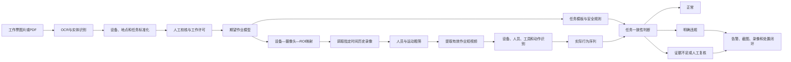

# 工作票与视频智能联动实施方案

## 1. 建设目标

本方案用于实现工作票识别系统与现场视频分析系统的联合应用。系统根据工作票中规定的作业时间、作业地点、目标设备、工作任务、工作人员和安全措施，自动定位对应摄像头，调取指定时间范围内的录像，提取真实作业片段，并判断现场人员是否：

- 在许可时间内作业；
- 位于工作票规定的地点；
- 操作工作票规定的设备；
- 执行工作票允许的工作任务；
- 出现票外作业、错设备操作或禁止动作；
- 落实安全帽、工装、监护人等安全措施。

系统输出正常、明确违规或待人工复核三类结果，并保存关联工作票、视频截图、短视频、判断规则及模型置信度，形成完整的安全追溯链路。

## 2. 核心设计原则

### 2.1 工作票是“期望作业模型”

工作票不能只保存为OCR文本。系统需要将票面内容转换成机器可以查询和比较的结构化数据，包括：

- 在什么时间作业；
- 在什么地点作业；
- 对哪台设备作业；
- 执行什么任务；
- 哪些人员可以参与；
- 允许出现哪些动作；
- 禁止出现哪些动作；
- 需要落实哪些安全措施。

### 2.2 视频系统只上报客观事实

视频系统负责识别人员、设备、工具、动作、区域和PPE等客观事实，不直接解释整张工作票，也不单独决定最终是否违规。

最终业务判断由联动服务根据工作票、视频事实和安全规则共同完成。

### 2.3 长录像先筛选、后精细分析

系统不应直接使用复杂模型分析数小时完整录像，而应先通过人员检测、设备ROI和运动信息筛选出真正发生作业的短视频，再进行设备、动作、工序和安全措施分析。

### 2.4 判断结果必须可解释

每条告警应明确说明：

- 工作票要求是什么；
- 视频中观察到了什么；
- 命中了哪条规则；
- 证据来自哪个摄像头和哪个时间段；
- 模型判断的置信度是多少；
- 是否需要人工复核。

## 3. 总体架构



系统建议拆分为以下模块：

1. **工作票解析服务**：负责OCR、NER、字段标准化和人工校核。
2. **资产与摄像头映射服务**：管理地点、设备、摄像头和ROI的关系。
3. **录像检索服务**：调用VMS、NVR或录像存储系统获取历史视频。
4. **视频分析服务**：识别人员、设备、工具、PPE和动作。
5. **任务合规判断服务**：比较期望任务和实际行为，生成判断结果。
6. **证据与告警服务**：保存截图、短视频、规则依据和处置记录。

## 4. 工作票结构化设计

### 4.1 必要字段

| 分类 | 字段 | 用途 |
|---|---|---|
| 票证 | ticket_id、ticket_no、ticket_version | 唯一识别工作票及其版本 |
| 状态 | DRAFT、APPROVED、ACTIVE、SUSPENDED、CLOSED | 判断当前是否允许作业 |
| 时间 | planned_start、planned_end、permit_start、permit_end | 检索录像并判断提前或超时作业 |
| 地点 | station_id、location_id、location_name | 关联现场区域和摄像头 |
| 设备 | device_id、device_name、device_aliases | 判断是否操作正确设备 |
| 任务 | task_code、task_name、task_description | 匹配标准任务模板 |
| 人员 | person_id、name、role、qualification | 判断人员身份、角色和资质 |
| 措施 | required_ppe、requires_guardian、safety_measures | 判断安全措施是否落实 |
| 规则 | allowed_actions、forbidden_actions、required_steps | 判断任务是否与票面一致 |

### 4.2 期望作业模型示例

工作票原文示例：

> 2026年8月13日09:00至12:00，在#2主变区域，对#2主变A相套管进行油位检查，工作人员张三、李四，要求佩戴安全帽，监护人全程在场。

结构化结果：

```json
{
  "ticket_id": "T20260813001",
  "ticket_no": "20260813001",
  "ticket_version": 1,
  "status": "ACTIVE",
  "permit_start": "2026-08-13T09:00:00+08:00",
  "permit_end": "2026-08-13T12:00:00+08:00",
  "station_id": "station_001",
  "location_id": "loc_xfmr_002",
  "location_name": "#2主变区域",
  "device_id": "dev_xfmr_002_bushing_a",
  "device_name": "#2主变A相套管",
  "task_code": "TRANSFORMER_BUSHING_OIL_INSPECTION",
  "task_name": "套管油位检查",
  "allowed_person_ids": ["P001", "P002"],
  "required_roles": ["WORK_LEADER", "GUARDIAN"],
  "required_ppe": ["HELMET", "WORK_CLOTHES"],
  "allowed_actions": [
    "approach_device",
    "visual_inspection",
    "take_photo",
    "record_result"
  ],
  "forbidden_actions": [
    "open_device",
    "remove_component",
    "use_grinder",
    "enter_live_area"
  ]
}
```

### 4.3 字段标准化要求

OCR或大模型抽取出的地点和设备名称必须与资产台账进行实体链接。例如：

```text
OCR文本：2号主变A相套管
标准设备：#2主变A相套管
标准设备ID：dev_xfmr_002_bushing_a
匹配置信度：0.94
```

如果无法唯一匹配，应进入人工校核流程，不能直接启动自动判断。

## 5. 设备、地点与摄像头关联

### 5.1 建立静态映射台账

现场投用前，需要对每个固定摄像头进行一次标定，记录：

- 摄像头唯一ID；
- 摄像头覆盖地点；
- 画面中可见的设备；
- 每台设备在画面中的多边形ROI；
- 摄像头对设备的可见度和优先级；
- 球机观察设备时使用的PTZ预置位；
- 录像平台中的通道编号。

示例：

```json
{
  "camera_id": "cam_001_fixed",
  "channel_id": "vms_channel_1001",
  "location_id": "loc_xfmr_002",
  "device_id": "dev_xfmr_002_bushing_a",
  "roi_id": "roi_bushing_a_001",
  "roi_polygon": [[620, 180], [910, 190], [950, 690], [580, 700]],
  "visibility": 0.91,
  "priority": 1,
  "camera_type": "FIXED"
}
```

### 5.2 Neo4j关系设计

在现有关系基础上增加：

```text
Camera -[COVERS]-> Location
Device -[LOCATED_AT]-> Location
Camera -[OBSERVES {roi_id, roi_polygon, visibility, priority}]-> Device
Ticket -[TARGETS]-> Device
Ticket -[AUTHORIZED_AT]-> Location
Ticket -[REQUIRES]-> SafetyMeasure
```

摄像头查询示例：

```cypher
MATCH (t:Ticket {ticket_id: $ticket_id})-[:TARGETS]->(d:Device)
MATCH (c:Camera)-[r:OBSERVES]->(d)
RETURN c.camera_id,
       c.channel_id,
       r.roi_id,
       r.roi_polygon,
       r.visibility,
       r.priority
ORDER BY r.priority ASC, r.visibility DESC
```

### 5.3 多摄像头选择策略

当多台摄像头可以看到同一设备时，按以下顺序选择：

1. 设备可见度最高；
2. 设备遮挡最少；
3. 录像清晰度最高；
4. 固定机优先于需要临时转动的球机；
5. 主视角和辅助视角同时保留；
6. 多视角时间必须同步。

如果没有摄像头能够看到目标设备，应直接返回“视频条件不满足”，不能生成违规结论。

## 6. 历史录像获取方案

### 6.1 录像来源

优先复用现有视频平台的历史回放能力：

- VMS或NVR提供的REST API、SDK；
- GB/T 28181历史录像回放；
- ONVIF Profile G；
- 海康、大华等厂商平台接口；
- 自建视频录像和对象存储服务。

普通RTSP地址通常只能获取实时流，不能按照历史时间直接回放。如果当前系统只有RTSP，需要增加录像服务。

### 6.2 自建录像存储

可将视频按5分钟或10分钟切片，保存到本地存储或MinIO：

```text
videos/{camera_id}/{yyyy-mm-dd}/{HH}/{start_time}_{end_time}.mp4
```

录像索引表：

```sql
CREATE TABLE video_segment (
    segment_id      VARCHAR(64) PRIMARY KEY,
    camera_id       VARCHAR(64) NOT NULL,
    start_time      TIMESTAMP NOT NULL,
    end_time        TIMESTAMP NOT NULL,
    storage_url     TEXT NOT NULL,
    duration_sec    INTEGER,
    checksum        VARCHAR(128),
    created_at      TIMESTAMP DEFAULT CURRENT_TIMESTAMP
);
```

### 6.3 录像检索接口

```http
GET /api/v1/video/playback
    ?camera_id=cam_001_fixed
    &start=2026-08-13T08:55:00+08:00
    &end=2026-08-13T12:05:00+08:00
```

建议在工作票许可时间前后各扩展5至10分钟，用于发现提前开工或结束后继续作业。

### 6.4 时间同步

必须保证以下时间统一：

- 工作票服务器时间；
- 视频平台时间；
- 摄像头时间；
- AI分析服务器时间；
- 数据库时间及时区。

所有设备应使用统一NTP服务，并在事件中保存ISO 8601时间和时区。

## 7. 有效作业视频提取

### 7.1 第一级：长视频粗筛

以较低频率分析完整录像，例如每秒1至2帧，检测：

- 是否有人进入目标设备ROI附近；
- 画面中是否存在明显运动；
- 人员是否长时间停留；
- 是否出现工具或车辆；
- 人员是否与目标设备发生空间接触。

粗筛结果示例：

```text
09:12:20—09:18:40：目标设备附近存在人员活动
10:31:05—10:36:18：目标设备附近存在人员活动
```

每段候选视频前后扩展30至60秒，以保留完整的进入、作业和离开过程。

### 7.2 第二级：短视频精细分析

只对候选片段运行高成本模型：

- 人员检测；
- ByteTrack或DeepSORT人员跟踪；
- PPE检测；
- 人员身份或角色识别；
- 设备和工具识别；
- 人体姿态估计；
- 动作识别；
- 时序工序识别；
- 视频多模态大模型复核。

## 8. 工作任务一致性判断

### 8.1 判断维度

系统从以下五个维度联合判断。

#### 时间一致性

```text
实际作业时间是否位于工作票许可时间内
```

可识别：

- 未许可作业；
- 提前作业；
- 超时作业；
- 暂停期间作业；
- 工作票终结后继续作业。

#### 地点一致性

根据`camera_id + roi_id`确定人员所在地点，并与工作票中的`location_id`比较。

#### 设备一致性

第一阶段优先使用人工标定的设备ROI。人员主要作业轨迹进入哪个设备ROI，即认为其正在接近或操作该设备。

可进一步结合：

- 设备外观检测模型；
- 设备铭牌OCR；
- 球机PTZ预置位；
- 人员UWB或蓝牙定位；
- 设备二维码或视觉标志；
- 门禁与设备舱门传感器。

#### 任务和动作一致性

将工作票任务映射到标准任务模板，再比较视频中的实际动作序列。

例如：

| 工作任务 | 允许动作 | 明确异常动作 |
|---|---|---|
| 套管油位检查 | 接近、观察、拍照、记录 | 拆卸、切割、打磨 |
| 保护装置调试 | 操作测试仪、查看屏柜、记录 | 操作非目标屏柜 |
| 设备清扫 | 擦拭、吸尘 | 打开禁止开启的间隔 |
| 套管更换 | 拆卸、起吊、安装 | 无监护起吊、进入带电区 |

#### 安全措施一致性

检查：

- 是否佩戴安全帽和规定工装；
- 监护人是否在场；
- 人员数量是否符合要求；
- 围栏和标示牌是否存在；
- 是否进入禁止区域；
- 登高和起吊防护是否落实；
- 是否出现吸烟、明火或其他禁止行为。

### 8.2 标准任务模板

```json
{
  "task_code": "TRANSFORMER_BUSHING_OIL_INSPECTION",
  "task_name": "套管油位检查",
  "target_device_types": ["TRANSFORMER_BUSHING"],
  "required_roles": ["WORKER", "GUARDIAN"],
  "required_ppe": ["HELMET", "WORK_CLOTHES"],
  "allowed_tools": ["CAMERA", "FLASHLIGHT", "RECORD_TERMINAL"],
  "allowed_actions": [
    "approach_device",
    "visual_inspection",
    "take_photo",
    "record_result"
  ],
  "forbidden_actions": [
    "remove_component",
    "use_grinder",
    "welding",
    "enter_live_area"
  ],
  "required_steps": [
    {"sequence": 1, "action": "approach_device"},
    {"sequence": 2, "action": "visual_inspection"},
    {"sequence": 3, "action": "record_result"}
  ]
}
```

### 8.3 规则示例

```text
规则：错设备作业
条件：实际设备ID != 工作票目标设备ID
并且：人员在实际设备ROI内持续停留超过30秒
并且：检测到工具使用或设备交互动作
结果：WRONG_DEVICE_OPERATION
```

```text
规则：票外作业
条件：实际动作属于任务模板的forbidden_actions
并且：动作置信度 >= 0.85
并且：动作持续时间 >= 3秒
结果：OUT_OF_SCOPE_WORK
```

```text
规则：证据不足
条件：目标设备被严重遮挡
或者：动作置信度低于阈值
或者：关键时间段录像缺失
结果：MANUAL_REVIEW
```

## 9. 算法与模型建议

| 分析能力 | 推荐技术 |
|---|---|
| 人员、工具和PPE检测 | YOLO系列模型 |
| 人员连续跟踪 | ByteTrack或DeepSORT |
| 固定设备判断 | 多边形ROI与轨迹相交判断 |
| 人体姿态 | YOLO Pose、RTMPose等 |
| 短动作识别 | 姿态特征加时序分类器 |
| 长动作和工序识别 | VideoMAE、SlowFast、ActionFormer等 |
| 复杂片段语义复核 | 视频多模态大模型 |
| 最终业务判断 | Python规则引擎，后续可使用OPA |

视频多模态大模型适合对短片段进行语义复核，例如判断人员是在观察油位计还是拆卸部件，但不应由其单独给出最终违规结论。

## 10. 判定结果与证据设计

### 10.1 三态结果

系统必须支持三类结果：

| 状态 | 含义 |
|---|---|
| COMPLIANT | 有充分证据表明实际作业与工作票一致 |
| VIOLATION | 有明确证据表明存在违章 |
| MANUAL_REVIEW | 录像、角度或模型置信度不足，需要人工复核 |

### 10.2 输出示例

```json
{
  "analysis_id": "AN202608130001",
  "ticket_id": "T20260813001",
  "ticket_version": 1,
  "result": "VIOLATION",
  "violation_code": "WRONG_DEVICE_OPERATION",
  "expected_device_id": "dev_xfmr_002_bushing_a",
  "expected_device_name": "#2主变A相套管",
  "observed_device_id": "dev_xfmr_002_bushing_b",
  "observed_device_name": "#2主变B相套管",
  "observed_action": "使用扳手进行拆卸",
  "camera_id": "cam_001_fixed",
  "roi_id": "roi_bushing_b_001",
  "start_time": "2026-08-13T10:31:05+08:00",
  "end_time": "2026-08-13T10:32:18+08:00",
  "confidence": 0.88,
  "snapshot_url": "/evidence/EV001.jpg",
  "clip_url": "/evidence/EV001.mp4",
  "rule_id": "RULE_WRONG_DEVICE_001",
  "review_status": "PENDING"
}
```

### 10.3 证据保存要求

每条分析结果应保存：

- 工作票编号和版本；
- 目标设备与任务；
- 摄像头ID和ROI；
- 原始录像索引；
- 事件前后短视频；
- 关键帧截图；
- 人员和设备检测框；
- 人员跟踪轨迹；
- 动作识别结果；
- 命中的规则；
- 模型版本和阈值；
- 人工复核与处置记录。

## 11. API接口设计

### 11.1 工作票许可

```http
POST /api/v1/linkage/tickets/{ticket_id}/activate
```

请求内容：

```json
{
  "ticket_version": 1,
  "permit_start": "2026-08-13T09:00:00+08:00",
  "permit_end": "2026-08-13T12:00:00+08:00",
  "location_id": "loc_xfmr_002",
  "device_ids": ["dev_xfmr_002_bushing_a"],
  "task_code": "TRANSFORMER_BUSHING_OIL_INSPECTION",
  "camera_ids": ["cam_001_fixed"],
  "work_roi_ids": ["roi_bushing_a_001"]
}
```

### 11.2 录像查询

```http
GET /api/v1/linkage/video-segments
    ?camera_id=cam_001_fixed
    &start=2026-08-13T08:55:00+08:00
    &end=2026-08-13T12:05:00+08:00
```

### 11.3 发起任务分析

```http
POST /api/v1/linkage/tickets/{ticket_id}/analyze
```

```json
{
  "ticket_version": 1,
  "analysis_mode": "ARCHIVE",
  "include_pre_post_minutes": 5
}
```

### 11.4 视频事实事件

```http
POST /api/v1/linkage/video-events
```

```json
{
  "event_id": "EV202608130001",
  "camera_id": "cam_001_fixed",
  "roi_id": "roi_bushing_a_001",
  "event_time": "2026-08-13T09:36:15+08:00",
  "event_type": "PERSON_DEVICE_INTERACTION",
  "track_id": "track_38",
  "device_id": "dev_xfmr_002_bushing_a",
  "action": "visual_inspection",
  "confidence": 0.91,
  "snapshot_url": "/evidence/EV202608130001.jpg",
  "clip_url": "/evidence/EV202608130001.mp4"
}
```

### 11.5 查询分析结果

```http
GET /api/v1/linkage/tickets/{ticket_id}/analysis-results
```

## 12. 数据库建议

### 12.1 PostgreSQL

适合保存：

- 工作票及版本；
- 许可状态；
- 标准任务模板；
- 摄像头台账；
- 录像索引；
- 视频事件；
- 任务分析结果；
- 人工复核和处置记录。

### 12.2 Redis

适合缓存：

- 当前有效工作票；
- 摄像头对应的活跃作业；
- 实时人员轨迹；
- 短时间窗口内的视频事件；
- 去重和告警抑制状态。

### 12.3 Neo4j

适合表达和查询：

- 地点、设备、摄像头的空间关系；
- 工作票、任务、人员和安全措施关系；
- 设备组成关系；
- 任务、风险和规则之间的关联。

不建议将所有高频实时事件只保存在Neo4j中。

## 13. 当前项目改造建议

建议在现有`service`目录增加：

```text
service/
├── ticket_task_normalizer.py   # 工作内容标准化和任务编码
├── camera_linker.py            # 根据地点和设备查找摄像头
├── video_archive_client.py     # 调用NVR或VMS获取历史录像
├── work_clip_extractor.py      # 从长录像中提取有效作业片段
├── video_fact_client.py        # 调用视频识别服务并统一事实格式
├── task_compliance_engine.py   # 期望任务与实际行为比对
├── evidence_service.py         # 管理截图、录像和证据链
└── action_templates/
    ├── oil_inspection.json
    ├── relay_testing.json
    ├── equipment_cleaning.json
    └── equipment_replacement.json
```

统一分析流程：

```text
读取工作票
→ 标准化地点、设备和任务
→ 人工确认并许可
→ 查询设备对应摄像头和ROI
→ 获取工作时间段录像
→ 提取有人作业的短视频
→ 识别实际设备、工具、人员和动作
→ 与任务模板及安全规则比较
→ 生成正常、违规或待复核结果
→ 保存证据并进入处置闭环
```

## 14. 分阶段实施计划

### 第一阶段：最小可用闭环

选择：

- 1个变电站；
- 3至5台固定设备；
- 2至3个固定摄像头；
- 油位检查、设备清扫、保护调试3类任务；
- 人工标定设备ROI。

完成以下判断：

1. 是否在许可时间内作业；
2. 是否位于正确地点；
3. 是否靠近正确设备；
4. 是否出现明确禁止动作；
5. PPE和监护是否符合要求。

### 第二阶段：动作与身份增强

- 增加工具识别；
- 增加人员身份或角色识别；
- 训练重点任务的动作模型；
- 引入动作时序和工序顺序判断；
- 增加多摄像头轨迹关联；
- 建设更多标准任务模板。

### 第三阶段：多源数据融合

- 接入门禁数据；
- 接入UWB或蓝牙人员定位；
- 接入设备运行状态；
- 接入接地线、舱门等传感器；
- 接入操作日志和调度系统；
- 使用知识图谱和规则引擎进行综合推理。

## 15. 验收指标建议

| 指标 | 第一阶段建议值 |
|---|---|
| 工作票地点标准化准确率 | ≥95% |
| 工作票设备标准化准确率 | ≥95% |
| 设备—摄像头映射完整率 | 100% |
| 录像检索成功率 | ≥99% |
| 人员进入设备ROI召回率 | ≥95% |
| 明确PPE违章准确率 | ≥90% |
| 错设备作业准确率 | ≥90% |
| 告警证据完整率 | 100% |
| 无法判断时正确转人工率 | ≥95% |

最终指标应根据现场摄像头角度、画质、遮挡和具体任务重新标定。

## 16. 风险与边界

### 16.1 普通监控无法看到所有操作细节

设备内部操作、细小按钮状态、接线正确性等内容可能无法从远距离视频准确识别，需要近景摄像头、设备状态数据或人工复核。

### 16.2 视频不能完全替代专业操作校验

视频可以判断人员是否在正确地点、是否接近正确设备、是否出现明显禁止动作，但复杂电气操作在技术上是否完全正确，仍需要结合：

- 设备遥信遥测；
- 操作票和操作日志；
- 门禁与锁具状态；
- 接地线传感器；
- 调度指令；
- 人工复核。

### 16.3 模型不确定时不得直接判罚

设备遮挡、夜间画质差、人员互相遮挡或录像缺失时，系统必须输出`MANUAL_REVIEW`，不能强行生成违规结论。

### 16.4 人员隐私与权限管理

涉及人脸、工号、录像和人员轨迹时，应执行最小权限、访问审计、数据脱敏、保存周期和证据导出审批制度。

## 17. 结论

工作票和视频真正联动的关键，不是简单地用工作票编号查询录像，而是建设以下两项基础能力：

1. **设备—地点—摄像头—ROI台账**：解决从工作票目标设备定位到对应视频的问题。
2. **标准任务模板库**：解决从票面工作内容推导允许动作、禁止动作和必要安全措施的问题。

在此基础上，系统通过工作票生成期望作业模型，通过摄像头录像获得实际行为序列，再由规则引擎进行一致性判断，才能可靠识别错时间、错地点、错设备、票外作业和安全措施未落实等问题。
